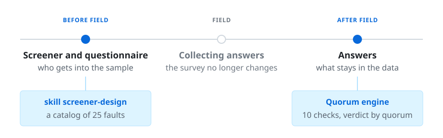
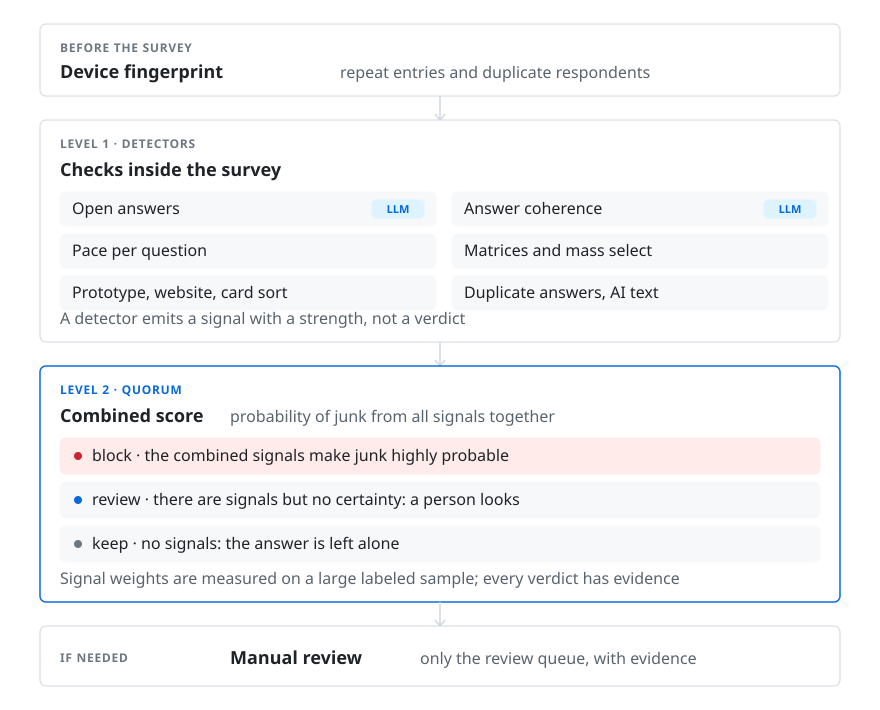

# SurveyQuorum

**So that the people in your study are the people you were looking for.**

An open toolkit for researchers: how to recruit respondents from external panels properly, how to keep people without the required experience out of the study, and how to clean the sample of junk quickly, effectively and cheaply once the field is closed.

[Русская версия — README.ru.md](README.ru.md)

## Where the project comes from

The project is led by [George Strunin](https://github.com/Rogeres), co-founder of Pathway. The repository grew out of his talk "Who really answers your surveys: measuring hidden junk in online samples, and open-sourcing the tools" at Research Expo on 2 October 2026 in Moscow. The method shown in the talk is published here in the open, and the figures in this text come from the talk.

## What problem does it solve?

The project is built on data from Pathway, a platform for product and marketing research: millions of answers from external panels and thousands of surveys written by researchers with very different experience. On a stream of that size, problems with answer quality show up as a pattern, not as isolated cases.


Above are real examples (in Russian): empty open answers, contradictions between the screener and the questionnaire, a random card sort, a prototype task abandoned after two seconds. In practice such answers cannot be rejected on a formal signal: on review, a share of them turns out not to be junk but a consequence of a peculiar study design or of mistakes in how the study was built.

**The quality of an answer is only visible with the full context of the study.** For the talk at Research Expo 2026 we labeled 10,000 random answers that reflect the stream: quality signals plus an expert verdict on each. About 6% are junk, the share grows with survey length and audience narrowness, and the number of signals in an answer correlates strongly with the expert verdict. The checking mechanism is built on this.

**Screening does more than a check after the field.** A strong screener cuts junk several times over and costs less than cleaning afterwards, while study authors without training systematically underestimate it.

Hence two directions: help build a strong screener before the field and clean up the remainder after it. The next section is about them.

## How does the mechanism work?

Before the field, checking the questionnaire and the screener is cheap: no domain knowledge is needed, an LLM skill with a detailed instruction on how to build a strong screener is enough, and the instruction is in this repository.

After the field, the remaining junk is cleaned almost automatically and before analysis: the mechanism finds low-quality answers and attaches evidence and a rejection reason to each. If your panel accepts a rejection with grounds, that is enough to get a refund for the low-quality answers: every verdict carries evidence and a ready complaint text.



| where | what goes wrong | tool |
|---|---|---|
| **Before the field.** Questionnaire and screener review | the filter hints the right answer, impostors get in, honest people are cut by logic that fights the quotas | **Screener skill** `screener-design`: builds a screener from a brief or reviews one against a catalog of 25 typical faults |
| **After the field.** Answer review | professional respondents, click-through, identical open answers | **Quorum**: ten independent checks, a verdict only when several agree, every verdict with evidence and a ready complaint text for the panel |

Both work from your AI agent: Claude Code, Cursor, Codex, Gemini CLI. No code to write.

## The reference check built on this method

The full version of Quorum runs in production at Pathway, where the platform adds its own data to each answer: the device fingerprint, the respondent's history, behaviour in the interface. What is published here is the same method reduced to an ordinary export of answers.



The full checking loop in Pathway. The open version has no "before the survey" level and lacks some first-level checks: the match to the declared audience and recognition of answers typed with AI assistance. They need data that an ordinary export does not carry.

Every answer, together with the study context, is checked for signals: strong and weak, towards junk and towards quality. The decision is not made on a single signal but on the probability of junk for the whole set: the signal weights are measured on a large labeled sample. If the combined signals make junk highly probable, the answer is blocked. If there are no signals, the answer is left alone. If there are signals but no certainty, a person looks at the answer, and an arbiter model takes most of that queue. The formula, weights and thresholds are in `docs/weights.md`, the detectors in `docs/detectors.md`.

**How this differs from the usual checks.** An attention check, total completion time or a panel's speed threshold look at a single signal, and a single signal is imprecise and noisy. Quorum does not block an answer on one signal: the decision rests on a set of independent checks, and every decision comes with evidence that can be re-examined.

A rejected answer is separated from the dataset and the researcher can bring it back. The rejection reason is assembled from the evidence automatically, so the complaint to the panel is ready at once.

## What is published here and why

Not every platform provides the data needed for the full check. So for the open version we looked for a mechanism that applies everywhere: to an ordinary export of answers, without access to the platform's internals, so that the problem can be fought anywhere. That is what is published here: simplified compared with Pathway but built on the same ideas — ten detectors, a weighted quorum with measured weights, and an arbiter as an optional stage.

Some checks are not in the open version yet: the device fingerprint and respondent history across surveys, the match to the declared audience, recognition of answers typed with AI assistance. They need data that an export usually does not carry, and we are still thinking about how to publish or replace them. So this is a beta: it can be used already, and the repository keeps growing.

## Using it without code

Both tools work from an AI agent: Claude Code, Cursor, Codex, Gemini CLI. Give the agent the link to this repository and say in plain words what you need. The agent reads the instructions, installs what it needs and asks questions if something is missing.

**Review a screener.** "Review this screener with the screener-design skill" and paste the screener text, or "Build a screener from this brief" and paste the brief. You get back a repaired screener in the editor's terms and an explanation of what was wrong and what it would have cost in the field.

**Check the answers.** "Screen the answers in answers.csv with surveyquorum". The agent brings the export into the common format, asks two or three questions about the structure, runs the checks and returns three groups: clean, probably junk, look by eye. Every verdict comes with evidence and a complaint text for the panel.

## Using it if you write code

Node 20+ and a clone of the repository. One engine, three ways to give it a model: an agent on a subscription, an API key or a local model, or the library in your own code.

**Answer checking, Quorum.**

```bash
git clone https://github.com/Rogeres/surveyquorum.git && cd surveyquorum && npm install
npm run surveyquorum -- run examples/demo-dataset.json --llm agent --llm-cache examples/llm-cache   # demo, judgements replayed from the cache
npm run surveyquorum -- convert export.csv --mapping my-mapping.json --out dataset.json             # your export into the common format
npm run surveyquorum -- run dataset.json --arbiter --out verdicts.json                              # a run with an API key
npm run surveyquorum -- explain verdicts.json <responseId>                                          # evidence for one answer
npm run surveyquorum -- complaints verdicts.json --dataset dataset.json --lang en                   # complaint texts for the panel
```

Without a key the eight statistical detectors run; the two LLM detectors and the arbiter need a model, configured in `docs/models.md`. As a library: `import { parseDataset, run } from 'surveyquorum'`. Import formats in `adapters/`, weights and thresholds in `docs/weights.md`, detectors in `docs/detectors.md`. The detailed description of commands, the demo and the status: `docs/usage.md`.

**Screener review, the screener-design skill.** Installed as a Claude Code plugin or copied as the `skills/screener-design` folder into another agent's rules. The fault catalog and the reference live next to the skill; the regression tests run with one command.

```bash
/plugin marketplace add Rogeres/surveyquorum && /plugin install surveyquorum@surveyquorum   # in Claude Code
npm run eval:screener                                                                        # 14 cases × 3 runs, about 9 minutes
```

## The screener fault catalog

The heart of the screener skill. Twenty-five faults, each with a card: what it is, **what it breaks in the field**, how to fix it, exceptions, a "bad" and a "good" example. A fault enters the catalog only with its sanction: if we cannot say what the fault costs, it is not a fault.

A few examples:

- **Yes/no on the target behaviour.** "Do you use a voice recorder?" An impostor passes with one click. The fix is a list of functions of the same kind with a limit, "most often, up to three".
- **Topic leak.** The brand is named in the welcome text or the first question. Professional respondents memorise the criterion for the next waves.
- **Logic against quotas.** A quota waits for people without the bank's card, and the screener throws them out. Two cells out of four can never be filled.

Full catalog: `skills/screener-design/catalog/README.md` (Russian cards with English summaries).

## Adding your own methodology

The catalog is open to changes, and every change is checked.

1. Write a fault card following the template: what it is, what it breaks, how to fix it.
2. Add an example: a draft screener with this fault and the list of what the skill must find.
3. Run one command. It runs every example through the model and shows a report: what was found, what was missed, whether anything old broke.

The examples are anonymised twins of real screeners: clients and brands replaced, structure and faults kept. So the check shows how the skill behaves on real questionnaires, not on textbook ones.

## What is measured and what is not yet

- The full version of Quorum runs in production at Pathway. This repository holds its first version, not tied to the platform, with regression tests on a synthetic demo. Results of a large run of the open version will appear here in due course.
- The screener skill: the catalog was built from a labeled dataset of real screeners. The regression set: 14 cases, each of the 25 catalog faults expected in at least one, with traps for the exceptions.

Details for developers: the engine, weights, detectors, API and import formats in `docs/`.

## Open beta

The repository is in beta: the production mechanism is simplified so that it can be applied to any study on any platform. Something surely does not work perfectly yet. Open issues, send pull requests; new cases for the checks and new typical screener faults are welcome.

Two tracks along which the repository grows:

1. **Skills.** The screener skill is built into the AI chat of the Pathway editor and is checked on real questionnaires. We extend the fault base with cases built from real examples.
2. **Quality checks.** The Quorum engine follows the production system but is simplified. As it runs on new data we will refine the methods and calibrate the weights.

## Who it is for

Researchers who recruit respondents on panels and are accountable for sample quality. Panel and platform teams that need a verifiable quality standard. Apache-2.0 license, changes via issues and pull requests, CITATION.cff for references in publications.
