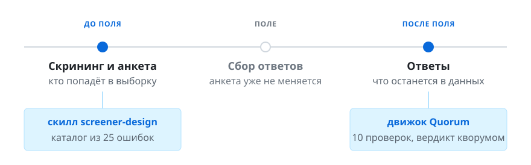
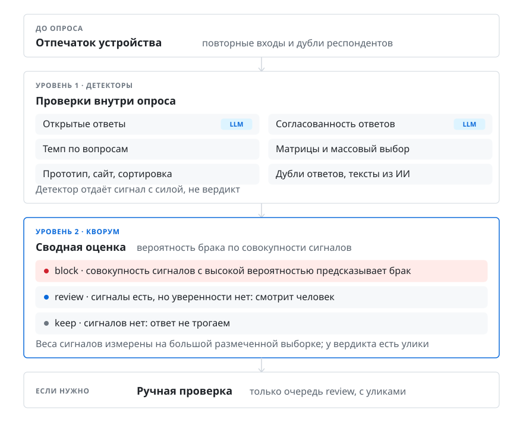

# SurveyQuorum

**Чтобы в вашем исследовании участвовали те, кого вы искали.**

Открытый набор инструментов для исследователей: как правильно привлекать респондентов из внешних панелей, как не допустить до исследования людей без необходимого опыта, как быстро, эффективно и недорого очистить выборку от мусора, когда поле уже закрыто.

[English version — README.md](README.md)

## Какую проблему решаем?

Проект основан на данных Pathway, платформы для продуктовых и маркетинговых исследований: миллионы ответов из внешних панелей и тысячи тестов от исследователей с разным опытом. На таком потоке проблемы с качеством ответов видны как закономерность, а не как отдельные случаи.


Выше реальные примеры: пустые открытые ответы, противоречия между скринингом и анкетой, случайная сортировка карточек или задание в прототипе, брошенное за две секунды. Отклонять подобные некачественные ответы по формальному признаку на практике не получается: часть таких ответов при разборе оказывается не браком, а следствием специфичного дизайна или ошибок сборки исследования.

**Качество ответа видно только при анализе полного контекста исследования.** Для доклада на ResearchExpo 2026 мы разметили 10 000 случайных ответов, отражающих поток: признаки некачественности плюс экспертная оценка каждого. Некачественных около 6 %, доля растёт с длиной анкеты и сужением аудитории, а число признаков в ответе сильно коррелирует с вердиктом эксперта. На этом построен механизм проверки.

**Скрининг решает больше, чем проверка после поля.** Сильный скрининг кратно снижает брак и обходится дешевле очистки, а авторы исследований без подготовки систематически его недооценивают.

Отсюда два направления: помочь собрать сильный скрининг до поля и вычистить остаток после него. О них следующий раздел.

## Как работает механизм?

До начала поля проверить анкету и скрининг дёшево: знать специфику не требуется, достаточно использовать LLM-скилл на базе подробной инструкции, как сделать сильный скрининг, она в репозитории.

После поля остаток брака вычищается почти автоматически и до анализа: механизм находит некачественные ответы и к каждому прикладывает улики и причину отбраковки. Большинство панелей принимают такую отбраковку и возвращают деньги за некачественные ответы.



| где | что идёт не так | инструмент |
|---|---|---|
| **До поля.** Проверка анкеты и скрининга | фильтр подсказывает правильный ответ, самозванцы проходят, честных отсеивает логика «против квот» | **Скилл скрининга** `screener-design`: собирает скрининг по брифу или проверяет готовый по каталогу из 25 типовых ошибок |
| **После поля.** Проверка ответов | профессиональные респонденты, прокликивание, одинаковые открытые ответы | **Quorum**: десять независимых проверок, вердикт только при согласии нескольких, у каждого вердикта улики и готовый текст жалобы в панель |

Оба работают из вашего AI-агента: Claude Code, Cursor, Codex, Gemini CLI. Кода писать не нужно.

## Как устроена проверка ответов в Pathway

Так выглядит полный алгоритм, который работает в платформе. Он опирается на данные, которые есть только у платформы: отпечаток устройства, история респондента, поведение в интерфейсе, запись того, как набирался текст.



Каждый ответ вместе с контекстом исследования проверяется на признаки: сильные и слабые, в сторону брака и в сторону качества. Решение принимается не по отдельному признаку, а по вероятности брака для их совокупности: веса сигналов измерены на большой размеченной выборке. Если совокупность сигналов с высокой вероятностью предсказывает брак, ответ блокируется. Если сигналов нет, ответ не трогают. Если сигналы есть, но уверенности нет, ответ смотрит человек, и большую часть этой очереди снимает арбитр-модель. Формула, веса и пороги в `docs/weights.md`, детекторы в `docs/detectors.md`.

Отклонённый ответ отделяется от массива, исследователь может его вернуть. Большинство панелей принимают отбраковку с причиной, и причина генерируется автоматически: у каждого вердикта есть улики.

## Что выложено в репозитории и почему

Не все платформы отдают необходимые данные для полной проверки. Поэтому для открытой версии мы искали механизм, который применим везде: к обычной выгрузке ответов, без доступа к внутренностям платформы, чтобы с проблемой можно было бороться повсеместно. Здесь выложен именно он: упрощённый в сравнении с Pathway, но на тех же идеях — десять детекторов, взвешенный кворум с измеренными весами и арбитр как необязательный этап.

Часть проверок в открытую версию пока не вошла: отпечаток устройства и история респондента между опросами, соответствие заявленной аудитории, распознавание ответов, набранных с помощью ИИ. Для их реализации нужны данные, которых в выгрузке обычно нет, и мы ещё решаем, как их правильно выложить или чем заменить. Поэтому это бета-версия: её уже можно применять, а репозиторий продолжает дополняться. Чем больше к нему интереса (звёздочек, запросов и предложений), тем активнее мы будем дополнять репозиторий.

## Как пользоваться без кода

Оба инструмента работают из AI-агента: Claude Code, Cursor, Codex, Gemini CLI. Дайте агенту ссылку на репозиторий и скажите обычными словами, что нужно. Агент сам прочитает инструкции, поставит что нужно и задаст вопросы, если чего-то не хватает.

**Проверить скрининг.** «Проверь скрининг этого теста по скиллу screener-design» и вставьте текст скрининга, или «Собери скрининг по этому брифу» и вставьте бриф. В ответ придёт исправленный скрининг в терминах редактора и объяснение, что было не так и чем это грозило в поле.

**Проверить ответы.** «Проверь ответы в answers.csv через surveyquorum». Агент приведёт выгрузку к общему формату, задаст два-три вопроса про структуру, прогонит проверки и вернёт три группы: чисто, вероятно брак, посмотреть глазами. К каждому вердикту улики и текст жалобы для панели.

> Видео: как это выглядит на реальном тесте. Ссылка появится здесь.

## Как пользоваться, если вы пишете код

Нужен Node 20+ и клон репозитория. Движок один, модель ему можно дать тремя способами: агент по подписке, API-ключ или локальная модель, библиотека в своём коде.

**Проверка ответов, Quorum.**

```bash
git clone https://github.com/Rogeres/surveyquorum.git && cd surveyquorum && npm install
npm run surveyquorum -- run examples/demo-dataset.json --llm agent --llm-cache examples/llm-cache   # демо, суждения из кэша
npm run surveyquorum -- convert export.csv --mapping my-mapping.json --out dataset.json             # своя выгрузка в общий формат
npm run surveyquorum -- run dataset.json --arbiter --out verdicts.json                              # прогон с API-ключом
npm run surveyquorum -- explain verdicts.json <responseId>                                          # улики по одному ответу
npm run surveyquorum -- complaints verdicts.json --dataset dataset.json --lang ru                   # тексты жалоб в панель
```

Без ключа работают восемь статистических детекторов; два LLM-детектора и арбитр требуют модель, настройка в `docs/models.md`. Как библиотека: `import { parseDataset, run } from 'surveyquorum'`. Форматы импорта в `adapters/`, веса и пороги в `docs/weights.md`, детекторы в `docs/detectors.md`. Подробное описание команд, демо и статуса: `docs/usage.ru.md`.

**Проверка скрининга, скилл screener-design.** Ставится как плагин Claude Code или копируется папкой `skills/screener-design` в правила другого агента. Каталог ошибок и справочник лежат рядом со скиллом, регрессионные тесты запускаются одной командой.

```bash
/plugin marketplace add Rogeres/surveyquorum && /plugin install surveyquorum@surveyquorum   # в Claude Code
npm run eval:screener                                                                        # 14 кейсов × 3 прогона, около 9 минут
```

## Каталог ошибок скрининга

Сердце скилла скрининга. Двадцать пять ошибок, у каждой карточка: что это, **что ломается в поле**, как чинить, исключения, пример «плохо» и «хорошо». Ошибка попадает в каталог только с санкцией: если нельзя сказать, чем платим за ошибку, это не ошибка.

Несколько примеров:

- **Да/нет на целевое поведение.** «Пользуетесь ли вы диктофоном?» Самозванец проходит одним кликом. Лечится списком функций того же рода с лимитом «чаще всего, не больше трёх».
- **Утечка темы.** Бренд назван в приветствии или в первом вопросе. Профессиональные респонденты запоминают критерий на следующие волны.
- **Логика против квот.** Квота ждёт людей без карты банка, а скрининг их выкидывает. Две группы из четырёх набрать невозможно.

Полный каталог на русском: `skills/screener-design/catalog/README.ru.md`.

## Как добавить свою методологию

Каталог открыт для правок, и каждая правка проверяется.

1. Напишите карточку ошибки по образцу: что это, что ломается, как чинить.
2. Добавьте пример: черновик скрининга с этой ошибкой и список того, что скилл должен найти.
3. Запустите одну команду. Она прогонит все примеры через модель и покажет отчёт: что найдено, что пропущено, не сломалось ли что-то из старого.

Примеры это обезличенные двойники реальных скринингов: клиенты и бренды заменены, структура и ошибки сохранены. Поэтому проверка показывает, как скилл поведёт себя на настоящих анкетах, а не на учебных.

## Что измерено, а что пока нет

- Полная версия Quorum работает в продакшене Pathway. В репозитории его первая версия, не привязанная к платформе, с регрессионными тестами на синтетическом демо. Результаты большого прогона открытой версии появятся здесь через некоторое время.
- Скилл скрининга: каталог собран по размеченному датасету реальных скринингов. Регрессионный набор: 14 кейсов, каждая из 25 ошибок каталога ожидается хотя бы в одном, у кейсов есть ловушки на исключения.

Подробно для разработчиков: движок, веса, детекторы, API и форматы импорта в `docs/`.

## Открытая бета

Репозиторий в бета-версии: механика из продакшена упрощена так, чтобы её можно было применить к любому исследованию на любой платформе. Что-то наверняка работает не идеально. Заводите issue, присылайте pull request; новые кейсы для проверок и новые типовые ошибки скрининга приветствуются.

Два трека, по которым репозиторий растёт:

1. **Скиллы.** Скилл скрининга уже работает у исследователей и встроен в AI-чат редактора Pathway. Мы регулярно проверяем качество его работы и пополняем базу ошибок кейсами на базе реальных примеров.
2. **Проверки качества.** Движок Quorum сделан по образцу реальной системы, но упрощён. По мере прогонов на новых данных мы будем оттачивать методы и калибровать веса.

Список фич на ближайшие релизы: в работе.

## Для кого

Исследователи, которые нанимают респондентов на панелях и отвечают за качество выборки. Команды панелей и платформ, которым нужен проверяемый стандарт качества. Лицензия Apache-2.0, правки через issue и pull request, для ссылок в публикациях есть CITATION.cff.
